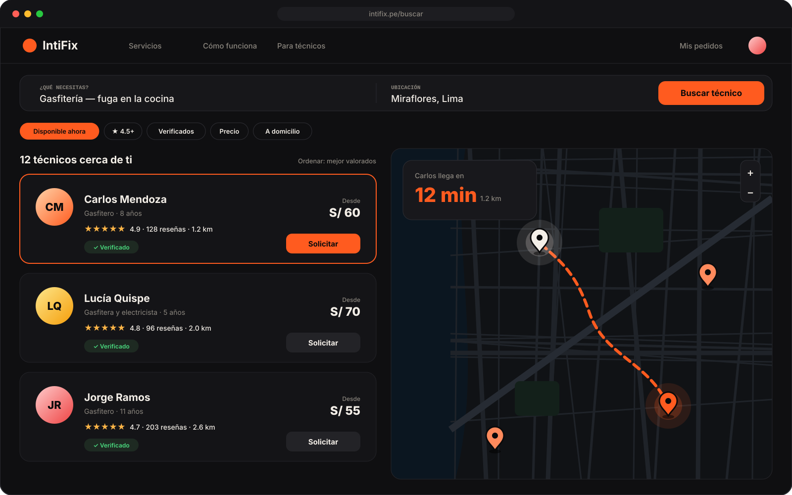
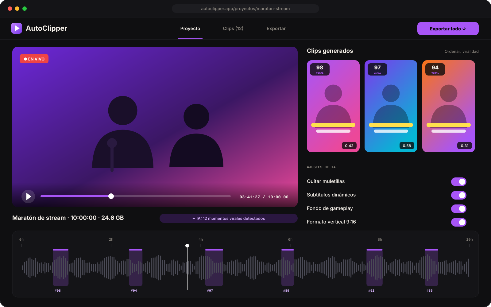
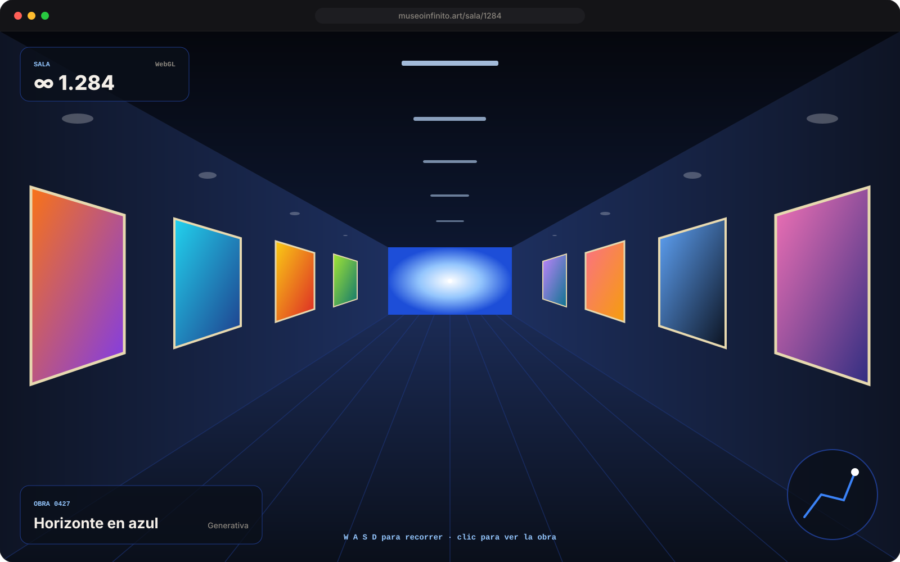
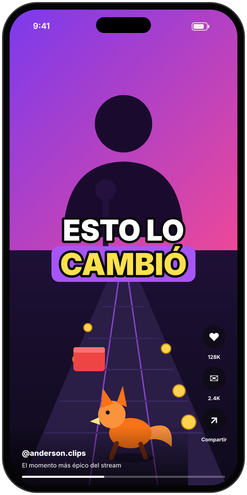
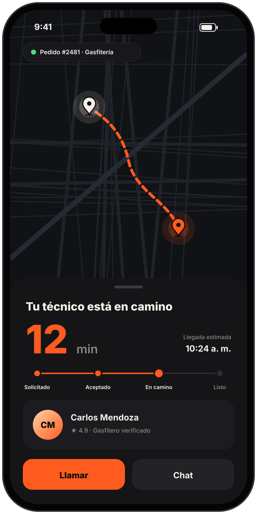
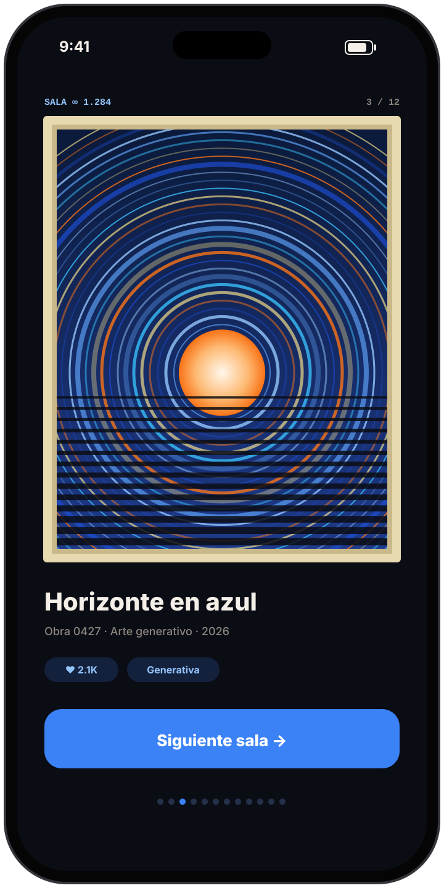

<div align="center">

<a href="https://riveranderson.duckdns.org">
  
</a>

# Anderson Rivera — Portafolio

**Desarrollador Full Stack · Lima, Perú**
Web, móvil e IA: desde microservicios resilientes hasta interfaces que se sienten vivas.

[](https://riveranderson.duckdns.org)


</div>

---

## ✦ Sobre el proyecto

Portafolio personal hecho desde cero con **Next.js (App Router)**, pensado como una experiencia: animaciones, transiciones entre páginas y un fondo líquido en WebGL, sin librerías de animación. Todo el movimiento está escrito a mano con CSS, `requestAnimationFrame` e `IntersectionObserver`.

Proyecto desarrollado para el curso **Desarrollo de Aplicaciones Web Avanzado** (Tecsup): aplicación web con SEO optimizado, página de contacto, sitemap, robots.txt y despliegue en Vercel con dominio personalizado.

## ✦ Proyectos destacados

| | Proyecto | Qué es |
|---|---|---|
| 🌞 | **[IntiFix](https://riveranderson.duckdns.org/projects/intifix)** | Plataforma que conecta clientes con técnicos de confianza para reparaciones del hogar. |
| ✂️ | **[AutoClipper](https://riveranderson.duckdns.org/projects/autoclipper)** | IA que convierte videos de horas en clips verticales con subtítulos, listos para redes. |
| 🖼️ | **[Museo Infinito](https://riveranderson.duckdns.org/projects/museo-infinito)** | Experiencia web inmersiva: un museo virtual que se genera sin fin mientras lo recorres. |

<p align="center">
  
  
</p>
<p align="center">
  
  
  
  
</p>

## ✦ Lo que tiene

**Experiencia**
- 🌊 **Hero con fondo líquido en WebGL** (shader propio con *domain warping*) que reacciona al mouse y se pausa cuando no está en pantalla.
- 🔤 **Nombre con fuente variable** que se adelgaza cerca del cursor, y entrada letra por letra.
- ⏳ **Preloader** 0 → 100 % y **transición de cortina** entre páginas.
- 🖱️ **Cursor personalizado** con inercia, botones magnéticos y etiquetas contextuales ("Ver caso", "Enviar").
- 📜 Textos que se revelan al hacer scroll, frase que se "enciende" palabra por palabra y cintas de tecnologías que aceleran con el scroll.
- 🗂️ **Tarjetas apiladas** (sticky) en el inicio y lista de proyectos con **vista previa que sigue al cursor**.
- ✉️ **Formulario de contacto** que arma el correo y lo abre en la app del visitante (sin backend).
- ♿ Respeta `prefers-reduced-motion` y funciona sin JavaScript.

**SEO**
- Metadata por página: título, descripción, **URL canónica**, Open Graph y Twitter Cards.
- **Imagen Open Graph generada** con `next/og` para compartir en WhatsApp, LinkedIn, X, etc.
- `sitemap.xml` y `robots.txt` dinámicos que usan el dominio de producción automáticamente.
- **Datos estructurados (JSON-LD)**: `WebSite`, `Person`, `CreativeWork` por proyecto y `BreadcrumbList`.
- Favicon, ícono para iPhone y `manifest` para instalar la web.
- Página 404 personalizada.

## ✦ Stack

| Área | Tecnologías |
|---|---|
| Framework | Next.js 16 (App Router, Cache Components, Turbopack) |
| UI | React 19, TypeScript, Tailwind CSS 4 |
| Animación | CSS, WebGL (GLSL), `requestAnimationFrame`, `IntersectionObserver` |
| SEO | Metadata API, `next/og`, JSON-LD |
| Deploy | Vercel + dominio personalizado |

## ✦ Estructura

```
src/
├── app/
│   ├── page.tsx                  # Inicio (hero, proyectos, servicios, stack)
│   ├── projects/page.tsx         # Lista de proyectos
│   ├── projects/[slug]/page.tsx  # Caso de estudio de cada proyecto
│   ├── about/page.tsx            # Sobre mí
│   ├── contact/page.tsx          # Contacto
│   ├── sitemap.ts · robots.ts    # SEO
│   ├── opengraph-image.tsx       # Imagen para compartir
│   ├── manifest.ts · icon.png    # Íconos y PWA
│   ├── template.tsx              # Transición entre páginas
│   └── layout.tsx                # Layout, fuentes, metadata global, JSON-LD
├── components/
│   ├── fx/                       # Efectos: HeroCanvas (WebGL), Cursor, Preloader, Reveal, Marquee…
│   ├── Header · Footer · HeroTitle · ProjectCard · ProjectList · ProjectShowcase · ContactForm
├── lib/
│   ├── data.ts                   # ✏️ Toda la información editable (datos, proyectos, skills)
│   └── seo.ts                    # Helpers de metadata y JSON-LD
└── types/index.ts
public/projects/                  # Mockups de los proyectos
```

## ✦ Correr en local

Requisitos: **Node.js 20+**

```bash
git clone https://github.com/rivera-anderson/mi-portafolio2.git
cd mi-portafolio2
npm install
npm run dev
```

Abre [http://localhost:3000](http://localhost:3000).

| Comando | Qué hace |
|---|---|
| `npm run dev` | Servidor de desarrollo |
| `npm run build` | Build de producción |
| `npm run start` | Sirve el build |
| `npm run lint` | Revisa el código con ESLint |

## ✦ Personalizar

Todo el contenido está en **`src/lib/data.ts`**: nombre, descripción, email, redes, proyectos, habilidades y servicios. Para cambiar las imágenes de un proyecto, pon tus capturas en `public/projects/` y actualiza `images` en ese archivo.

## ✦ Deploy en Vercel

1. Importa el repositorio en [vercel.com/new](https://vercel.com/new) y despliega (no requiere configuración).
2. En **Settings → Domains**, agrega tu dominio y configura el registro DNS que indique Vercel.
3. Haz **Redeploy**: el sitemap, el robots.txt y las URLs canónicas toman el dominio de producción solos.

Variables de entorno opcionales:

| Variable | Para qué |
|---|---|
| `NEXT_PUBLIC_SITE_URL` | Forzar la URL pública del sitio (si no, se usa el dominio de producción de Vercel). |
| `GOOGLE_SITE_VERIFICATION` | Código de verificación de Google Search Console. |

## ✦ Contacto

**Anderson Rivera** — Desarrollador Full Stack · Estudiante de Tecsup · Lima, Perú

- 🌐 [riveranderson.duckdns.org](https://riveranderson.duckdns.org)
- ✉️ [riveraanderson946@gmail.com](mailto:riveraanderson946@gmail.com)
- 🐙 [github.com/rivera-anderson](https://github.com/rivera-anderson)

<div align="center">
<sub>Hecho con Next.js en Lima · © 2026 Anderson Rivera</sub>
</div>
